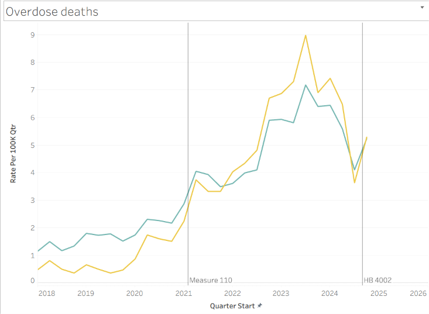

# Oregon Measure 110 — Drug Use & Medicaid Analysis

Analysis of drug-related outcomes in Oregon around Measure 110 (drug
decriminalization, effective 2021-02-01) and its partial rollback under
HB 4002 (recriminalization, effective 2024-09-01).

**▶ [Project write-up: results & dashboards](https://zhounapeuw.github.io/OR_measure_110/)** · [methods](https://zhounapeuw.github.io/OR_measure_110/methods.html)



## Pipeline

```
raw files (data/)  →  Python loaders  →  PostgreSQL (staging → marts)  →  Tableau
```
Thin Python loaders extract and lightly clean the raw source files into Oregon-only
staging CSVs; PostgreSQL does all the transformation/analysis SQL and serves the
result tables to Tableau Desktop over a live connection.

## Data sources

| Folder | Source | What it is | Cadence |
|--------|--------|------------|---------|
| `data/sdud/` | Medicaid State Drug Utilization Data (CMS) | Prescriptions reimbursed by Medicaid, per drug | Quarterly, 2018–2025 |
| `data/cdc_wonder/` | CDC WONDER Multiple Cause of Death | Oregon overdose deaths by drug category + population | Monthly, 2018–2024 |
| `data/MMA_enrollment/` | Oregon OHA / OHP | Medicare–Medicaid dual-eligible enrollment | Monthly |
| `data/SAMHSA/` | SAMHSA N-MHSS / N-SUMHSS | Treatment-facility surveys | Annual, 2019–2024 |

See `DATA_CHECKLIST.md` for known gaps, source URLs, and the plan to harmonize
everything to a quarterly Oregon panel.

## Documentation

- [`docs/data_dictionary.md`](docs/data_dictionary.md) — every source file and table, columns explained
- [`docs/methodology.md`](docs/methodology.md) — analytical decisions, rationale, and a dated decision log
- [`docs/drug_crosswalk.md`](docs/drug_crosswalk.md) — how SDUD product names map to drug classes, with caveats
- [`DATA_CHECKLIST.md`](DATA_CHECKLIST.md) — data inventory, known gaps, source URLs

## Setup

- **Python:** the `measure_110` conda environment (Python 3.12) — used for the
  loaders and the `psql` client.
  ```bash
  conda activate measure_110
  ```
- **PostgreSQL 17** installed via the EnterpriseDB installer, running as the Windows
  service `postgresql-x64-17` (auto-starts at boot). Connection:
  `host=127.0.0.1 port=5432 dbname=measure110 user=postgres password=postgres`.

## How to run

```bash
# 1. Stage the raw data (Oregon-only) into staging/
python loaders/load_sdud.py
#    (more loaders to come: CDC deaths/population, enrollment, SAMHSA)

# 2. Load + transform in PostgreSQL
#    Create tables and load the staging CSVs with \copy, then run the sql/ files.
#    (A build script will tie steps 1–2 together as the pipeline grows.)
```

## Tableau (live connection)

Tableau Desktop → Connect → PostgreSQL:
`127.0.0.1` / port `5432` / database `measure110` / user `postgres` / password `postgres`.
Connect to the mart tables (or use Custom SQL).

## Project layout

```
loaders/               # thin Python extract/clean -> staging CSVs
  load_sdud.py         #   SDUD: filter to Oregon, combine 8 years
  load_cdc.py          #   CDC deaths + population
sql/                   # PostgreSQL transformation & analysis SQL (run in name order)
  00_create_tables.sql #   create + load the source tables from staging CSVs
  10_overdose_rate.sql #   mart_overdose_rate (deaths per 100k by drug/year)
  20_rx_by_class.sql   #   mart_rx_by_class (MOUD/naloxone Rx per quarter)
docs/                  # methodology & reference notes
  data_dictionary.md   #   every source file and table, columns explained
  methodology.md       #   analytical decisions, rationale, decision log
  drug_crosswalk.md    #   how SDUD product names map to drug classes (+ caveats)
staging/               # Oregon-only staging CSVs (git-ignored; regenerate via loaders)
data/                  # raw source files (git-ignored): sdud, cdc_wonder, MMA_enrollment, SAMHSA
explore.ipynb          # exploration notebook (charts) — to be repointed to Postgres
DATA_CHECKLIST.md      # data inventory, gaps, and harmonization plan
```

## Status

- [x] Data collected (4 sources) and inventoried, consolidated under `data/`
- [x] PostgreSQL (EDB) running as a service; `measure110` database created
- [x] SDUD + CDC loaded into Postgres (`sdud_or`, `overdose_deaths`, `population`)
- [x] Overdose-rate marts (annual + quarterly) with suppression bounds
- [x] SDUD drug-class crosswalk + `mart_rx_by_class` (buprenorphine/naltrexone/naloxone)
      — incl. fixes for renamed products and the fills-vs-units metric trap
- [x] Tableau dashboard: overdose deaths vs. treatment access, one timeline w/ policy lines
- [ ] SAMHSA loader (buprenorphine facility/client census, 2021–2024 as cross-check)
- [ ] Interrupted-time-series statistics (the formal before/after test)
- [ ] Optional: enrollment as per-enrollee denominator (Medicaid unwinding); validation pass
