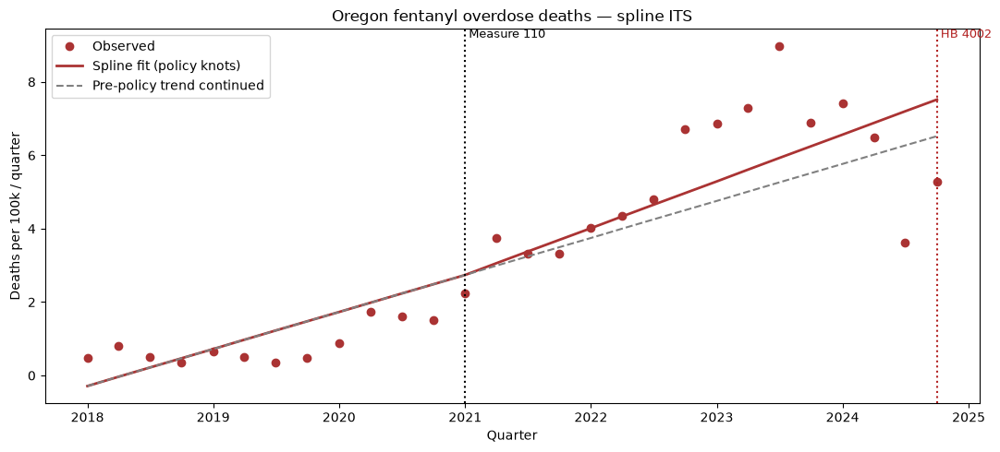
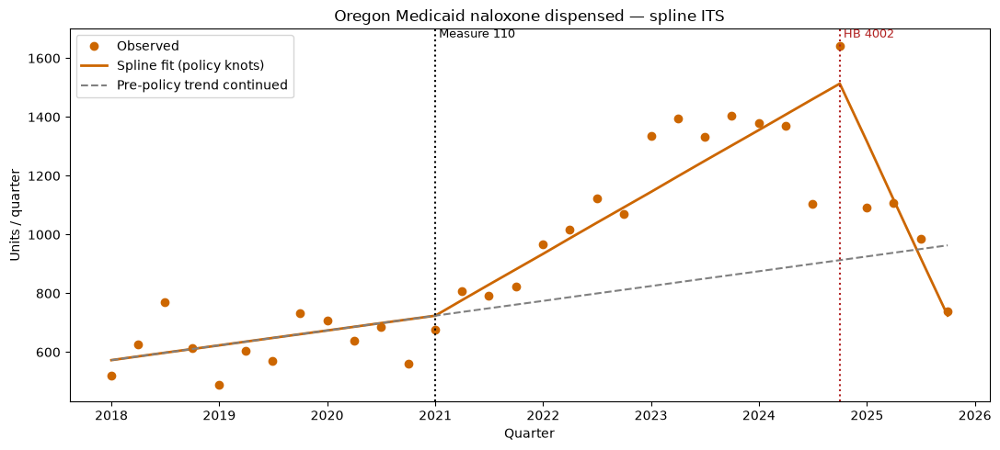
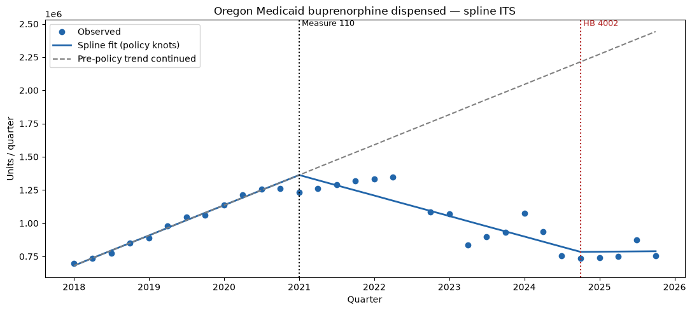

**Results** · [Methods →](methods.md) · [GitHub repo](https://github.com/zhounapeuw/OR_measure_110)

# Oregon Measure 110: Overdose Deaths & Treatment Access

In February 2021 Oregon decriminalized possession of small amounts of drugs (**Measure 110**). In September 2024 it partly reversed course (**HB 4002**). I combined CDC overdose death data, Medicaid prescription data, and Oregon Health Authority treatment metrics to look at what happened to overdose deaths and access to addiction treatment, and where in the state treatment is falling short.

### Key findings

1. **Fentanyl deaths were already rising before Measure 110.** The fentanyl overdose death rate nearly tripled before the policy (2.0 to 5.7 per 100,000, 2019–2020), kept rising after it took effect, peaked at 30.0 in 2023, then fell to 22.8 in 2024.
2. **There is no defensible evidence that Measure 110 changed the fentanyl trend.** The slope change at Measure 110 is not significant (p = 0.65), and the timing overlaps with the national fentanyl supply surge.
3. **Treatment access moved in different directions.** Medicaid naloxone (overdose reversal) rose after Measure 110. Medicaid buprenorphine (opioid addiction treatment) stopped growing and declined.
4. **Every CCO is below the state's treatment initiation benchmark.** Statewide, 41.7% of new substance use disorder (SUD) diagnoses start treatment within 14 days vs. a 48.6% benchmark, and rural/frontier counties do worse than urban ones (38.8% vs. 43.3%).

---

### Overdose deaths vs. treatment access

<tableau-viz src="https://public.tableau.com/views/OregonMeasure110/OregonMeasure110OverdoseDeathsvs_TreatmentAccess"
  toolbar="bottom" hide-tabs width="1100" height="1100"></tableau-viz>

[Open the dashboard on Tableau Public ↗](https://public.tableau.com/app/profile/charles.zhou3999/viz/OregonMeasure110/OregonMeasure110OverdoseDeathsvs_TreatmentAccess)

Quarterly overdose death rates for fentanyl (yellow) and methamphetamine (teal), with the two policy dates marked. Both drugs climb through 2023 and drop in 2024. The 2024 drop starts in **June 2024, before HB 4002** took effect, so it can't be credited to the rollback.

| Year | Fentanyl (per 100k) | Meth (per 100k) |
|---|---|---|
| 2019 | 2.0 | 6.8 |
| 2020 | 5.7 | 8.5 |
| 2021 | 12.6 | 14.3 |
| 2023 | **30.0** | **25.3** |
| 2024 | 22.8 | 21.4 |

### Did the policies change the trends? (Interrupted time series)

Each series gets the same model: a trend line that's allowed to bend at Measure 110 and again at HB 4002. The gray dashed line is the pre-policy trend continued.

**Fentanyl deaths:** rising before the policy (+0.25 per 100k per quarter, p < 0.001). The slope after Measure 110 is slightly steeper (+0.07) but **not significant (p = 0.65)**. CDC data ends 2024 Q4, so there are too few quarters to test HB 4002 yet.

**Naloxone:** the slope increased after Measure 110 (+40 units/quarter, p < 0.001) and turned sharply negative after HB 4002 (p < 0.001, but only 5 quarters of data after HB 4002). Naloxone has also been sold **over-the-counter** since 2023, which moves some purchases out of Medicaid claims, so a drop in Medicaid naloxone isn't necessarily less naloxone in the community.

**Buprenorphine:** growing steadily before Measure 110 (+57k units/quarter), then the trend reversed (−39k units/quarter, p < 0.001) and flattened out after HB 4002. Medicaid buprenorphine in 2024 was about 30% below its 2021 level.

**What the data and stats show:** the clearest breaks are in treatment, not deaths. **HOWEVER** none of these can be pinned on the policies alone:
- **Fentanyl supply shock** — the national fentanyl wave reached Oregon around the same time as Measure 110. Without a comparison state, the model can't separate the two.
- **Medicaid unwinding (2023–24)** — Oregon Health Plan enrollment protections from the pandemic ended, which shrinks every Medicaid-based count, including buprenorphine.
- **OTC naloxone (2023)** — moves some naloxone outside of Medicaid data.

### Where is treatment falling short? (CCO and county)

<tableau-viz src="https://public.tableau.com/views/OregonMeasure110/TreatmentGapsbyCounty"
  toolbar="bottom" hide-tabs width="1200" height="1300"></tableau-viz>

[Open the map dashboard on Tableau Public ↗](https://public.tableau.com/app/profile/charles.zhou3999/viz/OregonMeasure110/TreatmentGapsbyCounty)

The Oregon Health Authority tracks **IET (Initiation & Engagement of SUD Treatment)** for each CCO (Coordinated Care Organization, Oregon's Medicaid managed care plans):
- **Initiation** = % of new SUD diagnoses that start treatment within 14 days
- **Engagement** = % that have 2+ more visits or medication treatments within 34 days

| 2024, adults 18+ | Initiation | Engagement |
|---|---|---|
| Oregon statewide | 41.7% | 16.5% |
| Incentive benchmark | 48.6% | 18.1% |
| Urban | 43.3% | 17.3% |
| Rural | 38.8% | 15.2% |
| Frontier | 38.8% | 14.0% |

- **All 16 CCOs are below the initiation benchmark**, so this is a system-wide shortfall, not a few bad plans.
- **Rural and frontier counties trail urban ones** on both steps.
- **Initiation and engagement don't always go together.** Some areas get people into treatment but lose them, others the reverse. The county map splits counties into four groups (below on both / low initiation / low engagement / above on both) so support can be targeted: **outreach** where initiation is low, **retention** where engagement is low.

(Gilliam, Sherman, and Wheeler counties have suppressed rates, so 33 of 36 counties are mapped.)

### Takeaways

- Overdose deaths in Oregon follow the fentanyl supply more than either policy date.
- The bigger, more fixable gap is getting Medicaid members **into and through** treatment, especially outside urban areas.
- **Next step:** a comparison state or synthetic control to actually separate policy effects from the fentanyl wave.

---

Data: CMS State Drug Utilization Data, CDC WONDER, Oregon Health Authority CCO Metrics. Built with Python, PostgreSQL, and Tableau. [How it was built →](methods.md)
