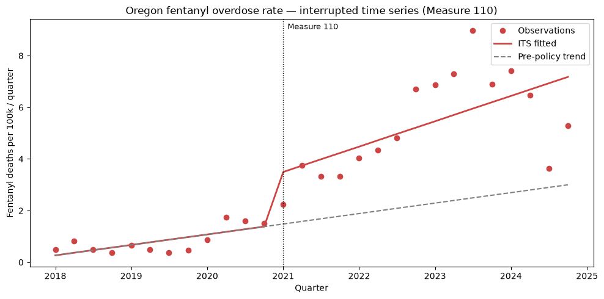

[← Results](index.md) · **Methods** · [GitHub repo](https://github.com/zhounapeuw/OR_measure_110)

# Methods

### Question

Did Oregon's **Measure 110** (drug decriminalization, effective 2021-02-01) or its partial rollback **HB 4002** (effective 2024-09-01) change overdose deaths or access to addiction treatment? And where in Oregon is treatment access falling short?

### Pipeline

```
raw files (data/)  →  Python loaders  →  PostgreSQL (staging → marts)  →  Tableau / Python (ITS)
```

- **Python loaders** (`loaders/`) only extract and lightly clean the raw files into Oregon-only staging CSVs. No analysis happens here.
- **PostgreSQL** does all the transformation and analysis SQL (`sql/`) and serves the final "mart" tables.
- **Tableau Desktop** reads the marts for the dashboards. The interrupted time series (ITS) stats are done in Python (`statsmodels`) on the same marts.

Why the split: Python is better for messy file handling (Excel sheets, footers, 3.7 GB of CSVs), SQL is better for transparent, checkable logic. Every loader is safe to re-run and rebuilds from the untouched raw files.

### Data sources

| Source | What it is | Grain | Years |
|---|---|---|---|
| **CMS State Drug Utilization Data (SDUD)** | Every outpatient prescription paid for by state Medicaid programs | drug package (NDC) × state × quarter | 2018–2025 |
| **CDC WONDER** (multiple cause of death) | Oregon overdose deaths by drug category + Oregon population | month (deaths), year (population) | 2018–2024 |
| **OHA CCO Metrics** | Oregon Health Authority quality metrics for each Coordinated Care Organization (CCO), incl. SUD treatment initiation & engagement (IET) | metric × CCO × year, and × county | 2019–2024 (IET) |

- SDUD: 8 national files (~41M rows) filtered to **752,611 Oregon rows**.
- CDC: 6 drug categories (fentanyl/synthetic opioids, meth, heroin, cocaine, methadone, Rx opioids), 612 drug-months.
- CCO: 9,583 metric rows (85 metrics, 16 CCOs + statewide) and county-level IET for 36 counties.

### Key data decisions

These are the decisions that changed the results the most if done wrong.

| Issue | What I did | Why it matters |
|---|---|---|
| **Fills vs. units** | Used `units_reimbursed` (quantity dispensed), not number of prescriptions | Buprenorphine moved from weekly to monthly fills (units per Rx 9.3 → 47.7). Counting fills makes treatment look like it fell **~5×** when it didn't |
| **Renamed products** | Drug-class crosswalk matches old *and* new SDUD product names (e.g. `BUPREN&NAL`, `BUP/NAL`, `BRIXADI`) and excludes look-alikes (`BUPROPION`, `IBUPROFEN`) | Missing renamed products undercounted recent years |
| **Suppressed death counts** | CDC hides monthly counts of 1–9. Kept them as flagged rows and carried a low / mid / high estimate (1 / 5 / 9 deaths) | Dropping them would bias early years (when fentanyl counts were small) downward |
| **SDUD data hole** | 2022 Q3 buprenorphine has ~771 units vs ~1.3M in neighboring quarters. Set to NULL | Otherwise it reads as a fake 99% crash |
| **County IET** | Used each county's "CCO statewide" row (all CCOs combined), not an average of CCO rows | Several CCOs serve each county and small CCO cells are suppressed. Averaging the visible CCOs gives the wrong rate (e.g. Lane: 0.472 vs true 0.399) |
| **Map thresholds** | Split counties at the 2024 statewide averages (initiation 41.7%, engagement 16.5%), not the 48.6% incentive benchmark | Almost every county is below the benchmark, so it would make the map uninformative |

More detail: [`methodology.md`](methodology.md) (dated decision log), [`drug_crosswalk.md`](drug_crosswalk.md), [`data_dictionary.md`](data_dictionary.md).

### Interrupted time series (ITS)

Each outcome is a quarterly series (fentanyl deaths per 100k, buprenorphine units, naloxone units). I fit a **piecewise-linear (spline) regression** with a "knot" at each policy, so the slope is allowed to bend at Measure 110 and again at HB 4002:

```
Y_t = β0 + β1·time + β2·(quarters since Measure 110) + β3·(quarters since HB 4002)
```

- `β1` = trend before Measure 110
- `β2` = change in slope after Measure 110
- `β3` = change in slope after HB 4002

The same spec is used for all three series so they're comparable.

**Standard errors:** time series noise is "sticky" (a high quarter is usually followed by another high quarter), so ordinary OLS standard errors are too small and give false significance. I used **Newey–West (HAC) standard errors** with 4 lags. The Durbin–Watson statistic confirms why: fentanyl DW = 0.64 (strong autocorrelation), naloxone DW = 1.91 (little).

**Sensitivity check:** an earlier version for fentanyl used the classic ITS form with an immediate *level jump* at Measure 110 (`Y = β0 + β1·time + β2·post + β3·time_since_post`). That model finds a significant jump (+2.0 per 100k, p = 0.011). The spline model, which doesn't allow a jump, finds no significant change (p = 0.65). The "effect" depends on the model choice — another reason not to read it as causal.



### Limitations

- **No control group.** A single-state series can't separate the policy from things that happened at the same time — the national fentanyl supply surge, OTC naloxone (2023), and Medicaid "unwinding" (2023–24, when pandemic-era enrollment protections ended). A comparison state or synthetic control would be the next step.
- **Small n.** ~28–32 quarters. Treat p-values as directional.
- **Medicaid only.** SDUD and IET cover Oregon Health Plan members, not people with private insurance or no insurance.
- **Units aren't the same across products.** SDUD units depend on the product form (tablets, films, mL), so units are best compared within a drug class over time, not across classes.
- **CCO IET is a cross-section.** The 18+ IET measure only exists from 2019 and its definition changed in 2022, so it's used for "where is the gap" (2024), not a before/after.
